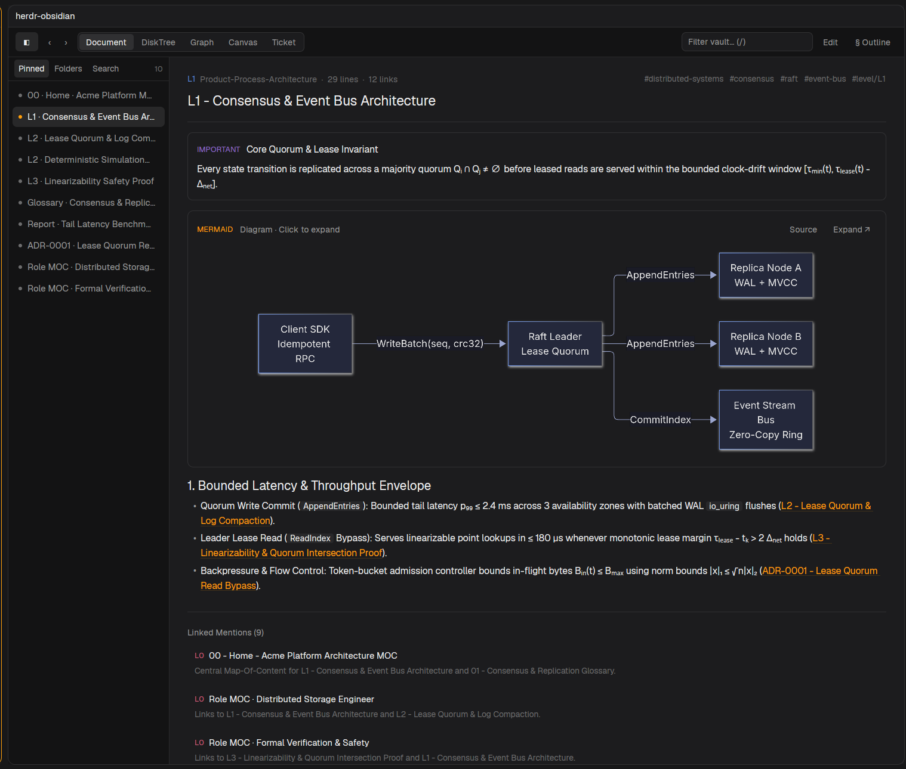

# `herdr-obsidian` — Integrated Obsidian Vault for Herdr-App & Herdr TUI

`herdr-obsidian` brings full Obsidian Vault navigation, reading, editing, `[[wikilink]]` & YAML alias resolution, incoming/outgoing backlinks, **Squarified DiskTree Treemap (`obsidian-disktree`)**, **JSON Canvas (`.canvas`) viewer**, **2D Knowledge Graph**, and **`herdr-kanban` Linked-Knowledge Brief sync** into a native GPU panel inside **Herdr-App** (`mods/herdr-obsidian`) and the **`herdr` TUI**.



## Quick Start

```bash
# 1. Install CLI symlink (~/.local/bin/herdr-obsidian), agent skills, and Herdr-App GPUI mod
./bin/herdr-obsidian install-skill --notify

# 2. Configure keybindings (Ctrl+Shift+O in Herdr-App, prefix+u in Herdr TUI)
./bin/herdr-obsidian setup-keys --notify

# 3. Verify vault discovery and installation
./bin/herdr-obsidian doctor
```

## Key Features

1. **Rich Note Reader & Live Editor (`1 · Note`)**:
   - YAML frontmatter property badges (`L0`–`L3`, `category`, `trl`, `access`, clickable `#tags`, `aliases`)
   - Styled Obsidian Callouts (`> [!note]`, `> [!important]`, `> [!tip]`, `> [!warning]`, `> [!caution]`)
   - Full-color GPU SVG & PNG figure rendering (`![[*.svg|caption]]` and ``) cached in `~/.config/herdr-app/data/obsidian-cache/`
   - Clickable `[[Target|Alias]]` wikilinks with back/forward history (`‹` / `›`)
   - Embedded Mermaid / Structurizr diagram cards with 1-click **`Render in Herdr Diagrams ↗`**
   - Live syntax-highlighted Markdown `Editor` (`e` to edit, `Ctrl+S` to save)
   - Collapsible right **Links & Outline Inspector** (`← Backlinks` with context snippets, `→ Outgoing`, `§ Headings`)
2. **Squarified DiskTree Treemap (`2 · DiskTree`)**:
   - Deterministic Bruls-Huizing-van Wijk squarified treemap colored by domain category (`MOC`, `Arch`, `Quality`, `IP`, `Proofs`, `Glossary`, `Reports`, `ADR/C4`)
   - Size by `Bytes`, `Lines`, or `Links (In+Out)`, filter by `L0`–`L3`, click group headers to drill into subfolders, or click any cell to open the note.
3. **Interactive 2D JSON Canvas Viewer (`3 · Canvas`)**:
   - Renders `.canvas` spatial architecture maps with drag/wheel 2D panning, zoom, group frames, and clickable file cards.
4. **2D Knowledge Graph (`4 · Graph`)**:
   - Switch between **Local Ego-Graph (1–2 Hops)** around the active note and **Global Hierarchy (`L0 → L3`)**.
5. **Agent & `herdr-kanban` Linked-Knowledge Brief (`5 · Ticket Brief`)**:
   - Automatically detects the active `herdr-kanban` ticket or worktree (`backend#42`, etc.) and organizes its Role MOCs, `L1`–`L3` Architecture notes, Glossary terms, ADRs, Formal Verification notes, and Quality reports.
   - Follows `[obsidian: <Note Title>]` markers in agent output or `herdr-obsidian open <note>` CLI invocations when `Sync ●` is active.
