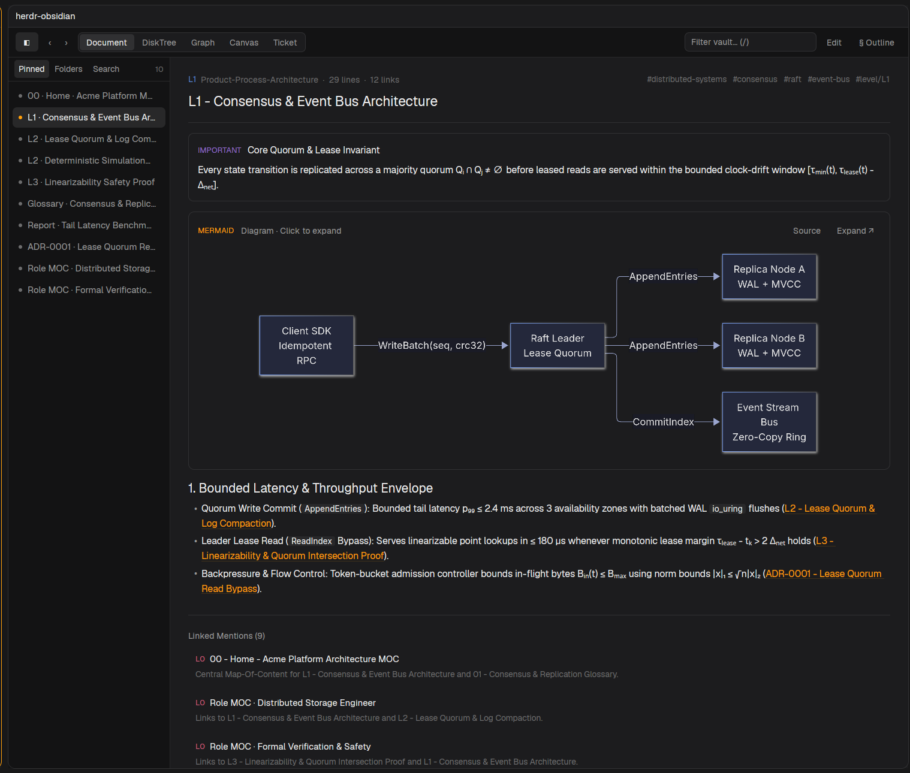

# Herdr Obsidian Vault

Integrated Obsidian Vault reader, live Markdown editor, `[[wikilink]]` & alias resolver, backlinks/outline inspector, Squarified DiskTree treemap (`obsidian-disktree`), 2D JSON Canvas (`.canvas`) viewer, 2D Knowledge Graph, and `herdr-kanban` Linked-Knowledge brief panel (`herdr-obsidian`) for Herdr-App across local and remote (`hc`) machines.

## What you see

- **Two-row header bar**:
  - **Row 1** (`38px`, `chrome` background): Obsidian crystal glyph (`15px`, `accent`), active vault title (`acme-platform/docs`), remote peer badge (`@peer-host` when viewing a remote `hc` space), vault counter pill (`48 notes · 312 links`), history buttons (`‹`, `›`, `⌂ Home`), live search input (`Search notes, [[wikilinks]], #tags, level:L1… (/)`) with clear (`×`) button, `+ Note` creation toggle, `Sync ●` / `Sync ○` terminal/agent sync button, `Edit` / `Save (Ctrl+S)` toggle, and `↻` refresh.
  - **Row 2** (`30px`, `surface` background): Left Vault sidebar toggle (`◀ Vault` / `▶ Vault`), **5 View Mode tabs** (`1 · Note`, `2 · DiskTree`, `3 · Canvas`, `4 · Graph`, `5 · Ticket Brief`), active `#tag` / `L0`–`L3` filter chips, and the right `Links & Outline (N)` inspector toggle.
- **Collapsible Left Vault Navigator (`236px`, `chrome` background)**:
  - **MOCs & Pins** tab: Curated `.obsidian/bookmarks.json` hubs and `00-Map-Of-Content (MOC)` entry points.
  - **Folders** tab: Expandable directory tree with category color dots, `L0`–`L3` depth badges, and note counts.
  - **Search** tab: Ranked full-text, title, YAML `aliases`, `#tag`, and `level:L0..L3` search results with context snippets.
  - **Tier filter bar**: 1-click progressive-disclosure filter buttons (`All`, `L0`, `L1`, `L2`, `L3`).
- **5 Main Interactive Views**:
  1. **Note View (`1`)**: Breadcrumb & YAML frontmatter pill bar (`L0`–`L3` tier badge, category chip, `trl:*`, `access:*`, clickable `#tag` pills), styled Obsidian Callout cards (`[!note]`, `[!important]`, `[!tip]`, `[!warning]`, `[!caution]`), native full-color GPU `image()` rendering for embedded `![[*.svg]]` and `` figures, inline dark-mode Mermaid/D2/PlantUML/Graphviz/Structurizr diagram rendering with a 1-click floating inspector (`Expand ↗`), LaTeX-to-Unicode math symbol rendering, selectable `TextView.markdown` prose where clicking any `[[Wikilink]]` navigates directly inside the vault, and an on-demand syntax-highlighted `Editor` (`e`) with `Ctrl+S` save.
  2. **DiskTree Squarified Treemap (`2`)**: Native GPUI implementation of `obsidian-disktree` using the Bruls-Huizing-van Wijk squarified treemap layout colored by category (`MOC`, `Arch`, `Quality`, `IP`, `Proofs`, `Glossary`, `Reports`, `ADR/C4`), sized by `Bytes`, `Lines`, or `Links (In+Out)`, with folder drill-down headers and click-to-open cells.
  3. **JSON Canvas Viewer (`3`)**: 2D pannable and zoomable `.canvas` viewer with canvas selector pills, group frames, color-coded file/text cards, SVG bezier edge connectors, and 1-click navigation to any file node.
  4. **2D Knowledge Graph (`4`)**: Pannable and zoomable node-link graph supporting **Local Ego-Graph (1–2 Hops)** around the active note and **Global Hierarchy (`L0 → L3`)** across the vault.
  5. **Ticket Brief (`5`)**: Live `herdr-kanban` Linked-Knowledge Brief synced to the active workspace/worktree ticket (e.g. `backend#42`), surfacing recommended skills, Definition-of-Done deliverables, Role MOCs, `L1`–`L3` Architecture notes, Glossary terms, ADRs, Formal Verification notes, and Quality reports.
- **Collapsible Right Connections & Outline Inspector (`236px`)**:
  - `← In (N)`: Incoming backlinks with source note `L0`–`L3` badge and surrounding sentence snippet.
  - `→ Out (M)`: Outgoing wikilinks from the active note.
  - `§ (K)`: Document heading outline (`H1`–`H4`).

## How it behaves

- Opens as a docked split pane beside your active terminal (`Ctrl+Shift+O` toggles open/close via `pane.split` / `pane.close`).
- Resolves `{ cwd, on, pane }` from `props()` or the active Herdr space (`spaces()`, `panes()`, `focused()`), discovering `.obsidian/`, `docs/.obsidian/`, or the parent Git repository of an isolated `herdr-kanban` worktree.
- Passes `{ cwd, on }` to every `exec("herdr-obsidian", [...], { cwd, on })` call and caches embedded SVG/PNG figures into `~/.config/herdr-app/data/obsidian-cache/<sha256>.<ext>` via `herdr-obsidian app-artifact` so both local and remote `hc` spaces render figures natively on the GPU without triggering mod hot-reloads.
- **Keyboard shortcuts** (`"focusable": true`): `/` (focus search), `1`–`5` (switch between `Note`, `DiskTree`, `Canvas`, `Graph`, `Ticket Brief`), `b` (toggle left vault sidebar), `i` (toggle right backlinks/outline inspector), `e` (toggle Markdown editor), `Ctrl+S` (save edited note), `Alt+h` / `Alt+l` (history back/forward), `+` / `-` / `0` (zoom in/out/reset on Canvas & Graph), `r` (refresh), `Escape` (close new-note bar or overlay).

## Built from

- `gpui-kit`: `View`, `div`, `svg`, `image`
- `gpui-base`: `v_flex`, `h_flex`, `Button`, `Input`, `InputState`, `Editor`, `EditorState`, `TextView`
- `herdr`: `spaces`, `panes`, `focused`, `exec`, `run`, `theme`, `settings`, `props`, `appHome`, `watchFolder`, `nextCommand`, `notify`, `closeOverlay`
- Backend CLI (`herdr-obsidian`): `app-state`, `app-artifact`, `open`, `read`, `write`, `search`, `backlinks`, `ticket`, `install-app-mod`, `install-skill`, `setup-keys`, `doctor`

## Watch out

- Never construct `InputState.new(...)`, `EditorState.new(...)`, or `cx.focus_handle()` inside `render()` — all retained inputs are created in `init(cx)` and `EditorState` is created in event/async callbacks.
- Never write cached SVG/PNG files inside `mods/herdr-obsidian/` (which triggers hot-reload and resets view state); always store cached figures in `~/.config/herdr-app/data/obsidian-cache/`.
- Never retain `cx` across `await`; always use the `cx` provided by `cx.spawn(async (cx) => ...)`.

## Done when

- `herdr-app check ~/.config/herdr-app/mods/herdr-obsidian` passes with exit code `0`.
- All 5 views (`Note`, `DiskTree`, `Canvas`, `Graph`, `Ticket Brief`), clickable `[[wikilinks]]`, backlinks inspector, embedded SVG figures, live editor, and `Ctrl+Shift+O` toggle work seamlessly.
